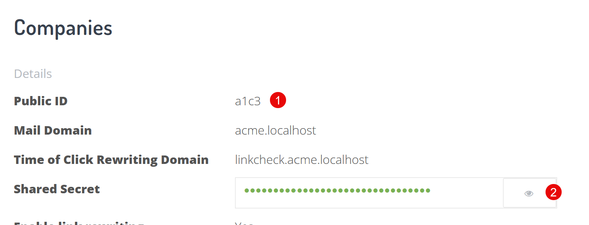

# Phish Redirector

Phish Redirector keeps your old Phish Protection links working. It reads a rewritten link, checks the link signature, and sends the browser to the original URL.

You can run it on Cloudflare Workers, on Vercel, or on your own web server with PHP.

## Why would I run this?

Phish Protection rewrites the links in your email. Each link points to your rewriting domain (for example `linkcheck.yourdomain.com`). These links stay in mailboxes, archives, and documents for many years.

Run Phish Redirector when one of these is true:

- **You stop using Phish Protection.** When the service stops, your rewriting domain stops working. All rewritten links in old email then break. Phish Redirector takes the place of the service on your rewriting domain, so the old links continue to work.
- **You change your rewriting domain.** New email uses the new domain. Old email still uses the old domain. Point the old domain to Phish Redirector, so the old links continue to work.

Phish Redirector does not check links for phishing. It only sends the browser to the URL that is in the link.

Phish Redirector is not an open redirect. It sends the browser only for links that have a correct signature from your Shared Secret. It refuses all other links.

Phish Redirector checks links with the same rules as Phish Protection. Thus, it accepts the links that Phish Protection accepted, for example:

- links with `&amp;` between the parameters, from mail clients that encode them
- links with a URL or recipient that a mail client encoded two times
- links with tracking parameters (such as `utm_source`) after the hash

It refuses the same unsafe links, for example:

- a link with a signed parameter added after the hash
- a link with a signed parameter as an array (`url[]=`)
- a signed link to a URL with a scheme other than `http`, `https`, `mailto`, `ftp`, or `tel`, for example `javascript:`

## Before you start

- Your rewritten links must use a hostname in a domain that you control. This is the **Time of Click Rewriting Domain** on your company profile.
- You must be able to change the DNS records for that hostname.
- You need the **Public ID** and the **Shared Secret** of your company. Get them before your Phish Protection account closes. If you have more than one company (domain), get the values for each company and deploy one copy for each rewriting domain.

## Find your values

1. Log in to the Phish Protection portal at [portal.phishprotection.com](https://portal.phishprotection.com).
2. In the top menu, select **Settings**, then select **Company**.
3. In the **Details** list, find these values:



| Number in the image | Value | Use it for |
| --- | --- | --- |
| 1 | **Public ID** | `PP_PUBLIC_ID` |
| 2 | **Shared Secret**. Click the eye icon to show the value. | `PP_SHARED_SECRET` |
| — | **Time of Click Rewriting Domain** | The hostname that you point to Phish Redirector, and `PP_LINK_DOMAINS` |

> **Warning:** Keep the Shared Secret private. A person who has the Shared Secret can make links that Phish Redirector accepts.

If you changed the Shared Secret at some time, the links from before that change use the old secret. Use the secret that was active when the links were made.

See also the support article [Migrating Phish Protection URLs](https://support.phishprotection.com/support/solutions/articles/5000821307).

## Settings

| Setting | Required | Value |
| --- | --- | --- |
| `PP_PUBLIC_ID` | Yes | The **Public ID** of your company. |
| `PP_SHARED_SECRET` | Yes | The **Shared Secret** of your company. |
| `PP_LINK_DOMAINS` | No | The link check domains that Phish Redirector accepts links on, separated by commas. For example: `linkcheck.yourdomain.com, oldlinks.yourdomain.com`. If you do not set it, Phish Redirector accepts links on all domains. |

Set `PP_LINK_DOMAINS` after you move your rewriting domain. Then Phish Redirector refuses links on all other hostnames, for example on its `workers.dev` or `vercel.app` hostname. The comparison ignores uppercase letters, the port, and a dot at the end. A subdomain does not match.

## Deploy to Cloudflare Workers

[](https://deploy.workers.cloudflare.com/?url=https://github.com/duocircle/phishredirector)

1. Click **Deploy to Cloudflare**.
2. Log in to Cloudflare and connect your GitHub or GitLab account.
3. Enter your **Public ID** in `PP_PUBLIC_ID`.
4. Enter your **Shared Secret** in `PP_SHARED_SECRET`.
5. Complete the steps to create and deploy the Worker.
6. [Test the deployment](#test-the-deployment) on its `workers.dev` hostname.
7. [Move your rewriting domain](#move-your-rewriting-domain) to the Worker.
8. Optional: Open the Worker, go to **Settings** > **Variables and Secrets**, and add `PP_LINK_DOMAINS`. See [Settings](#settings).

To deploy from the command line:

```sh
npx wrangler deploy
npx wrangler secret put PP_PUBLIC_ID
npx wrangler secret put PP_SHARED_SECRET
```

## Deploy to Vercel

[](https://vercel.com/new/clone?repository-url=https%3A%2F%2Fgithub.com%2Fduocircle%2Fphishredirector&project-name=phishredirector&repository-name=phishredirector&env=PP_PUBLIC_ID,PP_SHARED_SECRET&envDescription=The%20Public%20ID%20and%20Shared%20Secret%20from%20Settings%20%3E%20Company%20in%20Phish%20Protection.&envLink=https%3A%2F%2Fgithub.com%2Fduocircle%2Fphishredirector%23find-your-values)

1. Click **Deploy with Vercel**.
2. Log in to Vercel and connect your GitHub, GitLab, or Bitbucket account.
3. Enter your **Public ID** in `PP_PUBLIC_ID`.
4. Enter your **Shared Secret** in `PP_SHARED_SECRET`.
5. Click **Deploy**.
6. [Test the deployment](#test-the-deployment) on its `vercel.app` hostname.
7. [Move your rewriting domain](#move-your-rewriting-domain) to the project.
8. Optional: Open the project, go to **Settings** > **Environment Variables**, and add `PP_LINK_DOMAINS`. See [Settings](#settings). Then deploy the project again, because Vercel uses a changed variable only in a new deployment.

To deploy from the command line:

```sh
npx vercel link
npx vercel env add PP_PUBLIC_ID production
npx vercel env add PP_SHARED_SECRET production
npx vercel deploy --prod
```

## Deploy on your own web server (PHP)

You need a web server (Nginx, Apache, or Caddy) with PHP 7 or later, and an SSL certificate for your rewriting domain. The smallest VPS is sufficient.

1. Clone this repository.
2. Set the web root of the site to the `php` folder, so that `/` runs `php/index.php`.

   > **Warning:** Do not set the web root to the repository folder. If you do, the server publishes all the files in the repository, and your secrets if they are in a file there.

3. Set the `PP_PUBLIC_ID` and `PP_SHARED_SECRET` environment variables for PHP. You can also write the values at the top of `php/index.php`.
4. Get an SSL certificate for your rewriting domain.
5. [Test the deployment](#test-the-deployment).
6. [Move your rewriting domain](#move-your-rewriting-domain) to the server.
7. Optional: Set `PP_LINK_DOMAINS`. See [Settings](#settings).

### Upgrade from an older version

Older versions had `index.php` in the repository folder. This version has it in the `php` folder. If you wrote your values in the old `index.php`, `git pull` stops with the message `Your local changes ... would be overwritten`. Your old installation continues to work.

> **Warning:** After step 3, your links do not work until you complete step 6. Do steps 3 to 6 together.

1. Copy the `$pp_public_id` and `$pp_shared_secret` values from the old `index.php`.
2. Discard your change to the old file: `git checkout -- index.php`.
3. Run `git pull`.
4. Set the `PP_PUBLIC_ID` and `PP_SHARED_SECRET` environment variables for PHP, or write the values at the top of `php/index.php`.
5. Set the web root of the site to the `php` folder.
6. Restart the web server.
7. [Test the deployment](#test-the-deployment).

## Test the deployment

Do this test before you change DNS.

1. Find an email with a rewritten link. Copy the link.
2. In the link, replace the hostname with the hostname of your deployment. Do not change the path or the query string.

   ```
   https://linkcheck.yourdomain.com/?url=https%3A%2F%2Fexample.com%2F&rcpt=...&h=1a2b3c4d
   https://phishredirector-abc123.vercel.app/?url=https%3A%2F%2Fexample.com%2F&rcpt=...&h=1a2b3c4d
   ```

3. Open the changed link in a browser.
   - If the browser opens the original URL, the deployment is correct.
   - If you see `ERROR: could not verify URL!`, the Public ID or the Shared Secret is not correct.
   - If you see `ERROR: PP_PUBLIC_ID and PP_SHARED_SECRET are not set.`, set the two values and deploy again.
   - If you see `ERROR: This link is not valid on this domain.`, add the hostname to `PP_LINK_DOMAINS`, or remove `PP_LINK_DOMAINS` while you test.
   - If you see `ERROR: invalid URL!`, the signature is correct, but the link goes to a URL that Phish Redirector does not permit. Phish Redirector permits only the `http`, `https`, `mailto`, `ftp`, and `tel` schemes.

## Move your rewriting domain

Your rewriting domain now has a CNAME record that points to Phish Protection. Change it to point to your deployment.

- **Cloudflare Workers:** The DNS zone of your domain must be in your Cloudflare account. Delete the old CNAME record for the rewriting domain. Then open the Worker, go to **Settings** > **Domains & Routes**, click **Add**, and add the rewriting domain as a **Custom domain**. Cloudflare makes the DNS record and the SSL certificate.
- **Vercel:** Open the project, go to **Settings** > **Domains**, and add the rewriting domain. Change the CNAME record to the value that Vercel shows. Vercel makes the SSL certificate.
- **Your own server:** Change the CNAME record (or an A record) to point to your server.

If your domain has CAA records, make sure that they permit the certificate authority of your platform. If they do not, the platform cannot make an SSL certificate, and the links do not work.

DNS changes can take some hours to reach all users. After the change, do the [test](#test-the-deployment) again with the real rewriting domain.

## Development

The Cloudflare Workers and Vercel versions use the same code in `src/redirector.js`. This code gives the same result as `php/index.php`.

```sh
npm test
```

The tests send the links in `test/fixtures.json` to the JavaScript code. If PHP is installed, the tests also send them to `php/index.php`. To make the fixtures again, run `php test/make-fixtures.php`.

If PHP is installed, `test/parity.test.js` also sends 2000 random links to both versions and compares the results. To repeat a failure, set `PARITY_SEED` to the seed in the test name. To send more links, set `PARITY_COUNT`.

To test a running server, set `REDIRECTOR_URL` to an `http://` or `https://` URL. The server must use the `publicId`, `sharedSecret`, and `linkDomains` values from `test/fixtures.json`. The tests send the Host header from `test/fixtures.json`, so the server must accept that Host header.

```sh
cp .dev.vars.example .dev.vars   # Then write the test values in .dev.vars.
npx wrangler dev
REDIRECTOR_URL=http://127.0.0.1:8787/ npm test
```

## Contributing

Pull requests are welcome. For large changes, open an issue first to discuss what you want to change.
